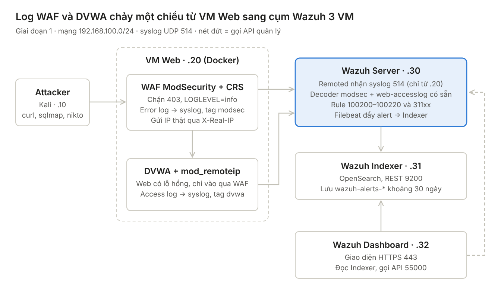

# VigilAI

Hệ thống phát hiện bất thường, hỗ trợ phân tích sự cố an toàn mạng dựa trên
Suricata, Zeek, Wazuh và trí tuệ nhân tạo — đồ án tốt nghiệp, PTIT.



## Giai đoạn 1: WAF → Wazuh

Tấn công web → WAF (ModSecurity + OWASP CRS v4) phát hiện → log WAF + access log DVWA
đẩy syslog UDP 514 → Wazuh Server (decoder/rule) → Indexer → Dashboard.

| VM | IP | RAM | Vai trò |
| --- | --- | --- | --- |
| Kali | 192.168.100.10 | 2 GB | Attacker (chỉ bật khi tấn công) |
| Web | 192.168.100.20 | 3 GB | Docker: WAF (`modsec`) + DVWA (`dvwa`) |
| Wazuh Server | 192.168.100.30 | 2 GB | remoted, analysisd (decoder + rule), API, Filebeat |
| Wazuh Indexer | 192.168.100.31 | 3 GB | OpenSearch (heap 1.5 GB, tắt swap), lưu `wazuh-alerts-*` |
| Wazuh Dashboard | 192.168.100.32 | 2 GB | Giao diện HTTPS 443 |

Mạng: VMware VMnet8 (NAT) `192.168.100.0/24`, DHCP tắt, gateway + DNS `.2`, máy thật `.1`, card `ens32`.
Máy thật 16 GB RAM. Ubuntu Server 24.04, Wazuh 4.14. User VM: `nguyen`.

## Cấu trúc repo

| Thư mục | Nội dung | Triển khai lên |
| --- | --- | --- |
| `web/` | `docker-compose.yml`, `dvwa/Dockerfile` | VM Web `~/lab-web/` |
| `wazuh/` | khối `ossec.conf`, decoder, rule, heap Indexer | Wazuh Server / Indexer |
| `infra/` | netplan từng VM, `hosts`, `config.yml` Wazuh, tắt cloud-init network | Mọi VM |
| `firewall/` | `ufw-rules.sh`, đoạn `DOCKER-USER` | 4 VM Ubuntu |
| `attacker/` | `attack.sh` | Kali |
| `samples/` | log thô + alert JSON mẫu (cho phần AI) | — |
| `dashboards/` | export saved search / dashboard | Wazuh Dashboard |
| `docs/` | kế hoạch, kiến trúc, đặc tả giao tiếp AI agent, ảnh chụp | — |

Các bước dựng chi tiết: [`docs/ke-hoach-gd1.md`](docs/ke-hoach-gd1.md).

## Triển khai nhanh

```bash
# VM Web
cd ~/lab-web && docker compose up -d --build

# Wazuh Server
sudo cp wazuh/decoders/modsec_decoders.xml /var/ossec/etc/decoders/
sudo cp wazuh/rules/modsec_rules.xml /var/ossec/etc/rules/
# thêm khối trong wazuh/ossec.conf.snippet vào /var/ossec/etc/ossec.conf
sudo /var/ossec/bin/wazuh-analysisd -t && sudo systemctl restart wazuh-manager

# Firewall (từng VM)
sudo ./firewall/ufw-rules.sh server|indexer|dashboard|web

# Kali
./attacker/attack.sh
```

## Bảo mật

Không commit `wazuh-install-files.tar`, mật khẩu, khóa (`.gitignore` đã chặn).
DVWA có lỗ hổng thật — chỉ chạy trong mạng lab, không mở ra Internet.

## Lộ trình

1. WAF → Wazuh (hiện tại)
2. Suricata + Zeek, Wazuh agent trên VM Web
3. AI agent phân tích, tương quan (xem `docs/interface-ai-agent.md`)
4. Active Response
5. TheHive / Shuffle (tùy chọn)
